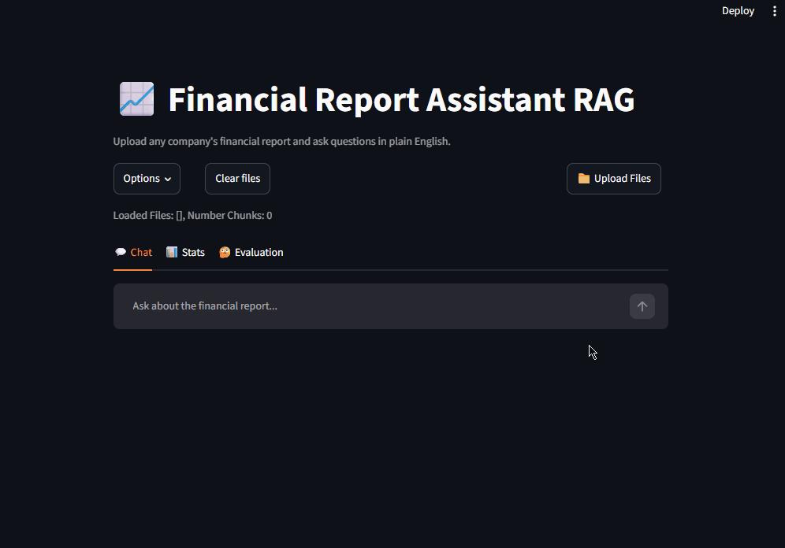
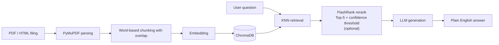

# Financial Report RAG



**[Website deployment](https://sieduckfinancialrag.streamlit.app/)** *Due to API constraints, please stick to the files in demonstration_files OR an equivalent of similar size or less*

Question-answering system that enables beginner investors to ask plain English questions about the financial statements of any company. 

## Evaluation results

Evaluated on a 20-question subset of [FinanceBench](https://github.com/patronus-ai/financebench)
spanning four 10-K filings (AMD, American Express, Boeing, PepsiCo FY2022), plus one custom
out-of-scope abstention question. Answers scored 1–5 by an LLM judge (a different
model from the generator, to reduce self-evaluation bias).

| Chunk size (words) |Chunk Overlap| Reranking | Judge score (/5) | Accuracy | Runtime (min) |
|---|---|---|---|---|---|
| 250 | 30 | ON  | 3.00 | 60.0% | 13.4 |
| 250 | 30 | OFF | 2.86 | 57.1% | 13.2 |
| 500 | 50 | ON  | 2.95 | 59.0% | 13.6 | 
| 500 | 50 | OFF | 3.48 | 69.5% | 13.3 |

**By question type** (best configuration CS=500, CO=50):

| Question type | n | Score (/5) |
|---|---|---|
| Extractive lookup | 11 | 2.91 |
| Computed metric | 6 | 3.83 |
| Metric-relevance judgment | 1 | 3.00 |
| Negative / abstention | 3 | 5.00 |

**Key findings:** *Note (A,B) refers to (Chunk Size, Chunk Overlap)*. Reranking at (250, 30), seems to have improved the model while at (500, 50) had negatively impacted model performance. (500, 50) with reranking=OFF had the best overall accuracy. The best performance being the higher chunk size + overlap is intuitive for a financial RAG context, as a higher chunk size leads to a greater amount of context per chunk, allowing more information for the model to generate an answer. Furthermore, reranking may have worsened performance, as at higher chunk sizes, noise is amplified making it harder for the reranking model to accurately judge the most appropriate chunks for the question.  

Full methodology, per-question results, and limitations: **[EVALUATION.md](EVALUATION.md)**

## How it works



## Tech Stack
- **Python:** >= 3.12
- **LLM:** gemini-2.5-flash // (LOCALLY qwen2.5:7b OR gemma4:e4b)
- **Embeddings:** gemini-embedding-001  // (LOCALLY qwen3-embedding)
- **Vector Store:** ChromaDB
- **PDF Parsing:** PyMuPDF
- **Re-ranking:** Flashrank
- **Front-end:** Streamlit

## How to run locally

1. Copy `.env.example` to `.env` and add your Gemini API key:
```
GEMINI_API_KEY=your_key_here
```

2. Install dependencies:
```bash
pip install -r requirements.txt
```

3. Run the app:
```bash
streamlit run app.py
```

### Optional: running with local models (Ollama)

The Gemini models work out of the box with an API key. To instead use the local
models available in the model dropdown (gemma4:e4b, qwen2.5:7b, qwen3-embedding),
you need [Ollama](https://ollama.com/download) installed and running:

```bash
ollama pull gemma4:e4b
ollama pull qwen2.5:7b
ollama pull qwen3-embedding
```

Then select the local models in the app's Options menu. Note: local models are
only available when running the app locally — the Streamlit Cloud deployment
supports the Gemini models only.
```

## Workings of each py file

1. **ingestpdf.py** - Load the PDFs, split them into chunks and embed using 'gemini-embedding-001'
2. **ragretrieve.py** - When question is asked, most relevant chunks are found using K-NN (ChromaDB)
3. **aiapi.py** - Retrieved chunks and questions get passed through to Gemini that goes ahead and generates a plain English answer
4. **evaluate.py** - Retrieves questions and answers from golden_dataset, then asks the question to the LLM, to which we compare the answer with the expected answer through judge-by-llm.
5. **app.py** - Streamlit UI interface for the entire application
6. **prodmonitoring.py** - Retrieves statistics regarding generation and saves them into 'monitor_log.json'
7. **config.py** - Default settings for model
8. **llm_model.py** - Stores the LLM API calls, allowing for easy implementation of new LLM models

## Roadmap
### Phase One
- [x] Document ingestion pipeline (PDF → chunks → embeddings → ChromaDB)
- [x] Vector search (ChromaDB KNN)
- [X] Retrieval reranking
- [X] Evaluation with golden datasets
- [X] LLM-as-judge for answer quality
- [X] Bare-bones frontend via Streamlit
- [X] Confidence thresholds (reject low-scoring retrievals)
- [X] Cost analysis per query (token usage)
- [X] config.py for tweakable parameters (chunk size, top-k, model, temperature)
- [X] Deploy to Streamlit Cloud

### Phase Two
- [X] Incorporate demonstration screenshots (GIF)
- [X] Seamless switching between Gemini and local Ollama LLM for local testing
- [X] Evaluation of a practical dataset to test retrieval accuracy
- [X] Batching of embeddings rather than querying one-by-one
- [X] Addition of rerank toggle for evaluation
- [X] Writeup of evaluation results and conclusions
 